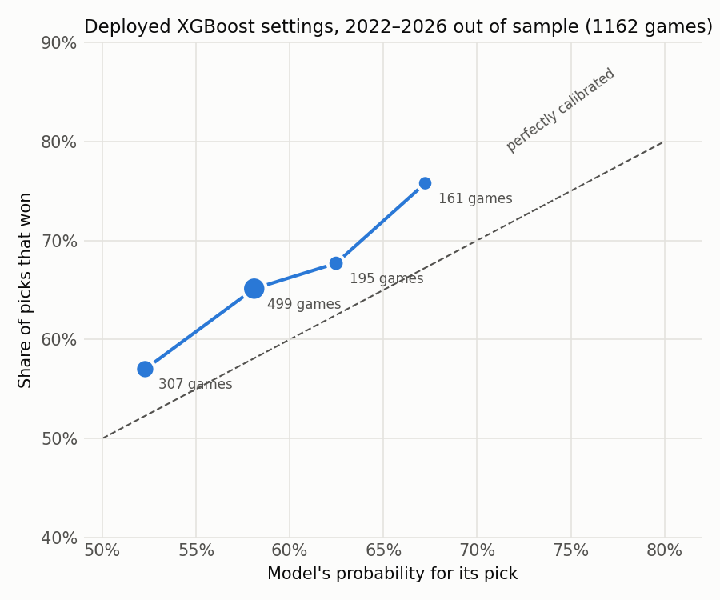

# QB-change feature and model blend experiment

Run 2026-10-14 with `../.venv/bin/python -m experiments.experiment_qb_blend` (from the nfl folder) (about 10 seconds). It is an offline comparison only. **No betting-market data is used anywhere.** The QB functions now live in `nfl_model_pipeline.py` and are shared with the weekly predictions.

**Correction (2026-10-14, evening).** The first version of this report took each game's starting QB from the nflverse schedule fields. Those fields can be stale: Seattle's 2026 Weeks 3–5 listed Drew Lock, but Sam Darnold threw every pass. For completed games the starter is now **the QB with the most dropbacks for that team**, taken from player stats. That corrected 16–50 team-games per season. Every number below uses the corrected starters, and the QB inputs came out somewhat stronger than in the first version.

## What was added

**QB inputs.** All are built from games before the target game's date.
- `qb_rating`: the starting QB's EPA per play (pass + rush + sacks). It is recency-weighted with a half-life of 16 of his own games and shrunk toward a below-average prior of −0.05 EPA/play worth 200 plays, so a backup with little history rates as a backup. These settings were fixed before any results were seen.
- `qb_change`: the starter differs from the team's most common starter over its previous 8 games. This flags injuries and benchings, returns from injury, and new signings for their first few weeks.
- `qb_delta`: the starter's rating minus the regular starter's rating, which tells the model which way the change cuts. `gap_qb_rating` and `gap_qb_delta` are the home-minus-away versions.

**QB-adjusted Elo.** This follows FiveThirtyEight's approach: `elo_gap + 400 × gap_qb_delta`, using the existing Elo. The weight of 400 was chosen by log loss on the 2022–24 validation games from a grid of 0–1000. A backup who is 0.2 EPA/play worse than the regular costs his team about 80 Elo points.

**Equal blend.** XGBoost, logistic regression and Elo are averaged with equal weights, without QB inputs (`blend_base`) and with them (`blend_qb`). XGBoost uses the deployed settings. The logistic strength was chosen by validation log loss (C = 0.01).

Validation uses six walk-forward folds over 2022–24 (813 games). Each later season is a frozen holdout: train on all earlier seasons, use features from prior weeks only. 2026 covers Weeks 1–5 (78 decided games).

## Results

| Model | 2022–24 validation | log loss | 2025 | log loss | 2026 W1–5 | log loss |
|---|---:|---:|---:|---:|---:|---:|
| Original XGBoost (`xgb_base`) | 536/813 (65.9%)* | .6467 | 169/271 (62.4%) | .6471 | 49/78 (62.8%) | .6603 |
| **XGBoost + QB** | 533 (65.6%) | .6409 | 174 (64.2%) | .6444 | 49 (62.8%) | .6474 |
| Logistic | 521 (64.1%) | .6455 | 169 (62.4%) | .6363 | 48 (61.5%) | .6718 |
| Logistic + QB | 530 (65.2%) | .6316 | 175 (64.6%) | .6308 | 49 (62.8%) | .6706 |
| Elo | 509 (62.6%) | .6407 | 173 (63.8%) | .6436 | 51 (65.4%) | .6362 |
| Elo + QB | 514 (63.2%)** | .6370** | 180 (66.4%) | .6351 | **52 (66.7%)** | **.6326** |
| Equal blend | 528 (64.9%) | .6363 | 175 (64.6%) | .6352 | 48 (61.5%) | .6431 |
| Equal blend + QB | 532 (65.4%) | **.6282** | **182 (67.2%)** | **.6286** | 48 (61.5%) | .6392 |

\* The deployed settings were selected on these same folds, so this figure is optimistic.
\** The Elo QB weight was chosen on these games, so this figure is optimistic. 2025 and 2026 are clean.

**Accuracy gains against the original XGBoost** (paired week-block bootstrap, 95% interval) in 2025: XGBoost + QB +1.8 pts [−1.8, +5.3], Elo + QB +4.1 [−1.1, +9.3], blend + QB +4.8 [+0.7, +9.7]. The blend + QB interval is the only one that clears zero. 2026 has only five weeks to resample, so its intervals mean little.

**Games with a QB change on either side**, where the feature should matter most: in 2025 (125 games) the original went 83–42, XGBoost + QB 85–40, Elo + QB 85–40 and blend + QB 88–37. In 2026 (37 games) the original went 21–16, XGBoost + QB 23–14 and Elo + QB 25–12.

## Calibration of the original model

Across 1,162 out-of-sample games (2022–24 validation, 2025 and 2026):

| Pick probability | Games | Model said | Actually won |
|---|---:|---:|---:|
| 50–55% | 307 | 52.3% | 57.0% |
| 55–60% | 499 | 58.1% | 65.1% |
| 60–65% | 195 | 62.5% | 67.7% |
| 65–70% | 161 | 67.2% | 75.8% |

The original model is **underconfident**: in every bucket its picks win more often than it says, and it never goes above about 69%. The QB blend is calibrated more closely and reaches higher probabilities when they are deserved: at 75%+ it made 82 picks and won 85.4% (`calibration_blend_qb.csv`).

## Conclusions

1. **The QB inputs help consistently.** With correct starters they improved log loss for XGBoost, logistic regression and Elo in validation, 2025 and 2026 alike. The gains show up in games with a QB change.
2. **XGBoost + QB is the safe drop-in replacement.** It uses the same model and settings as the original with eight more inputs. It was never worse on accuracy and always better on log loss. It became the official model from 2026 Week 6 (`nfl_xgb_c0f0f2b5583c`).
3. **Elo + QB and the blend + QB have the strongest numbers** (2025: 66.4% and 67.2%), but the blend was weak in 2026. Keep tracking both next to the official pick and decide at season end.

## Limitations

- 2025 was inspected in earlier experiments, so it is not a fresh test. 2026 is only 78 games.
- The QB settings (prior, half-life, 8-game window) were fixed and not tuned. The Elo QB weight was tuned only on 2022–24.
- For completed games, "starter" means the QB with the most dropbacks. When a starter is hurt early, his backup counts as the starter for that game.
- For upcoming games the starter comes from the nflverse schedule, which can be stale. The notebook's `qb_overrides` setting corrects it by hand.

## Files

`validation.csv`, `validation_qb_change_games.csv`, `elo_qb_search.csv`, `predictions.csv`, `calibration_*.csv`, `reliability_deployed.png`, `results.json`.
